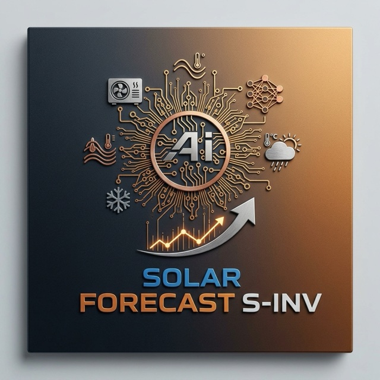

  

# Solar Forecast S-INV

**One integration for many inverters, batteries and meters – with the same entity names, units and signs for every manufacturer.**

S-INV is a Home Assistant integration (domain `solar_forecast_sinv`). You choose the manufacturer and the connection, enter an IP address or your account, and S-INV creates standardized entities such as `sensor.sinv_power_solar`, `sensor.sinv_power_grid` or `sensor.sinv_battery_soc`. Dashboards, automations, the energy dashboard and other integrations (for example Solar Forecast ML) work the same way, whatever hardware is installed.

> [!WARNING]
> **Early BETA.** S-INV is new and under active development. Please read the [Early BETA notes](#early-beta-notes) before installing it.

## Highlights

- **One standard for all manufacturers:** identical entity ids, units and signs (grid power positive = import, battery power positive = charging). The full data contract is in [CONTRACT.md](CONTRACT.md).
- **Mostly local:** apart from Anker, all systems are read on the local network – no cloud account, no internet connection needed.
- **Read only:** the local connections only read values; S-INV never writes settings to these devices.
- **Device "S-INV Anlage" (installation):** combines all inverters, batteries and meters of all S-INV entries into one set of totals – ready for the energy dashboard.
- **Several systems at once:** mix manufacturers, for example a Fronius inverter, a Hoymiles balcony system and a Zendure battery.

## Supported systems

Status: **tested** = runs on real devices; **protocol** = built from the manufacturer's documentation and checked with test data, waiting for feedback from testers with the device.

| Manufacturer | Devices | Connection | You need | Status |
|---|---|---|---|---|
| Anker Solix | Solarbank 1–3 (A17C0, A17C1, A17C2, A17C3, A17C5), Power Dock, MI60/MI80, smart meters, PPS, X1 and more | Anker cloud + MQTT | Anker account | tested |
| Fronius | Symo GEN24 (tested with BYD battery and Smart Meter); other inverters with Solar API such as Symo and Primo | Local network (Solar API); GEN24 optionally also Modbus TCP for PV and battery energy | IP address; for the extra GEN24 values Modbus TCP enabled on the inverter | tested (GEN24) |
| Sungrow | Hybrid inverters SH-RS, SH-RT, SH-T, SH-RL, SH-CX, MG-RL, MG-TL | Modbus TCP (LAN port or WiNet-S/S2 by cable) | IP address | tested |
| Zendure | SolarFlow 800, 800 Plus, 800 Pro, 1600 AC+, 2400 AC, 2400 AC+, 2400 Pro | Local network (zenSDK) | IP address, "Add HEMS" in the Zendure app | protocol |
| Hoymiles | Microinverters via OpenDTU | Local network (OpenDTU REST API) | IP address of the OpenDTU | protocol |
| Hoymiles | Microinverters via AhoyDTU | Local network (AhoyDTU REST API) | IP address of the AhoyDTU | protocol |
| Hoymiles | Original DTU (DTU-Pro, DTU-Lite, DTU-WLite) and HMS-xxxW inverters | Local network (hoymiles-wifi) | IP address | protocol |
| KOSTAL | PLENTICORE G2 (with or without battery) | Modbus TCP | IP address, Modbus enabled | protocol |
| SolaX | X1/X3-Hybrid G4, X1/X3-IES, X3-IES-P, X3-ULTRA | Modbus TCP (Pocket WiFi+LAN) | IP address | protocol |
| Huawei | SUN2000 L1/M1/M2/M3, LUNA2000 battery | Modbus TCP (SDongle or inverter access point) | IP address, Modbus TCP enabled on the dongle | protocol |
| Solakon | Solakon ONE | Modbus TCP | IP address | protocol |

Grid values (import, export) require a meter connected to the inverter or battery, as described in the setup dialog of each manufacturer.

**Your device is missing or behaves differently?** Please report it – with the diagnostics file, testers make new manufacturers possible.

## Installation

### HACS (custom repository)

1. HACS → three dots → **Custom repositories**.
2. Add the URL of this repository, type **Integration**.
3. Install **Solar Forecast S-INV** and restart Home Assistant.

### Manual

Copy `custom_components/solar_forecast_sinv` to `config/custom_components/solar_forecast_sinv` on the Home Assistant host and restart Home Assistant.

## Setup

1. Settings → Devices & services → **Add integration** → **Solar Forecast S-INV**.
2. Choose your system (manufacturer and connection).
3. Enter the IP address (or your Anker account). S-INV checks the connection before it saves the entry.
4. Repeat for every further system. The device **S-INV Anlage** is created automatically and combines all of them.

The polling interval can be changed in the options of each entry.

## Energy dashboard

S-INV does not change the energy dashboard settings itself, because existing grid, solar or battery entries would be counted twice. After setup, a one-time Home Assistant notification lists the sensors that exist on your installation. Add them under Settings → Dashboards → Energy:

| In the energy dashboard | Sensor |
|---|---|
| Grid consumption | `sensor.sinv_energy_grid_import_total` |
| Return to grid | `sensor.sinv_energy_grid_export_total` |
| Solar production | `sensor.sinv_energy_solar_total` |
| Battery: energy going in | `sensor.sinv_energy_battery_charge_total` |
| Battery: energy coming out | `sensor.sinv_energy_battery_discharge_total` |
| Grid power (standard, positive = consumption) | `sensor.sinv_power_grid` |
| Solar power | `sensor.sinv_power_solar` |
| Battery power (two sensors) | `sensor.sinv_power_battery_discharge`, `sensor.sinv_power_battery_charge` |
| Battery state of charge | `sensor.sinv_battery_soc` |

Use only these installation sensors, not additionally the counters of single devices or other sensors for the same energy.

## Early BETA notes

- **Not every manufacturer has run on a real device yet.** Systems marked "protocol" in the table were built from the manufacturer's documentation. Values, signs or scaling may still be wrong on your device. Please compare the values with the manufacturer's app for the first days.
- **Breaking changes are possible.** Until the release, entity names, the data contract or the setup flow may still change. An update can require removing and adding an entry again.
- **Not for critical automations yet.** Do not use S-INV values for safety-relevant or costly automations (for example grid charging) until your system has run stably for a while.
- **One connection at a time.** Some devices (Huawei SDongle, Hoymiles DTU, Solarman-type loggers) accept only a few parallel connections. Other integrations reading the same device at the same time can cause gaps.
- **Anker control functions** come from the upstream integration and change settings of your Anker system. All other manufacturers are read only.
- **Report problems** at https://www.solarforecastml.com/en/bugs and attach the diagnostics file (device page → three dots → *Download diagnostics*). Serial numbers in the file are your own data – check before sharing publicly.

## Anker Solix details

Device classes and Solarbank 3 message 0500

S-INV contains the full Anker Solix support of the upstream integration:

- Account and power system (site)
- Solarbank: A17C0, A17C1, A17C2, A17C3, A17C5
- Power Dock AE100
- Inverters MI60 (A5140) and MI80 (A5143)
- Smart meters A17X7, A17X7US, AE1X0, AE1R0, Shelly 3EM and 3EM Pro
- Smart plug A17X8
- Portable power stations (PPS), including Solarbank PPS A1782
- Power panel A17B1
- Home energy systems (X1) and battery module A5220
- Chargers A2345, A91B2, AS200
- EV charger A5191 and account vehicles
- Home backup A17E1 and AX170

Platforms: sensor, binary sensor, switch, select, button, number, datetime, text, time, update, and service actions.

For Solarbank 3 (A17C5), MQTT message `0500` is exposed as sensors on that model only: AC voltage and frequency, PV string voltage and current, internal temperatures, and for the main pack and installed expansions the cell voltages, temperatures, state of health and state of charge. `pv_<n>_power_calc` is voltage times current. Unidentified words are diagnostic sensors and are disabled by default.

## Documentation and support

- Documentation: https://www.solarforecastml.com/en/docs
- Bug reports: https://www.solarforecastml.com/en/bugs
- Data contract for developers and other integrations: [CONTRACT.md](CONTRACT.md)

## Credit and license

Copyright (C) 2026 Zara-Toorox. Proprietary Non-Commercial License, see [LICENSE](LICENSE) and https://www.solarforecastml.com/license.

Based on [ha-anker-solix](https://github.com/thomluther/ha-anker-solix) by Thomas Luther (@thomluther). The parts taken from it remain under the MIT License; its notice is in [LICENSE-ha-anker-solix](LICENSE-ha-anker-solix). The Hoymiles DTU connection uses the library [hoymiles-wifi](https://github.com/suaveolent/hoymiles-wifi) (MIT).
